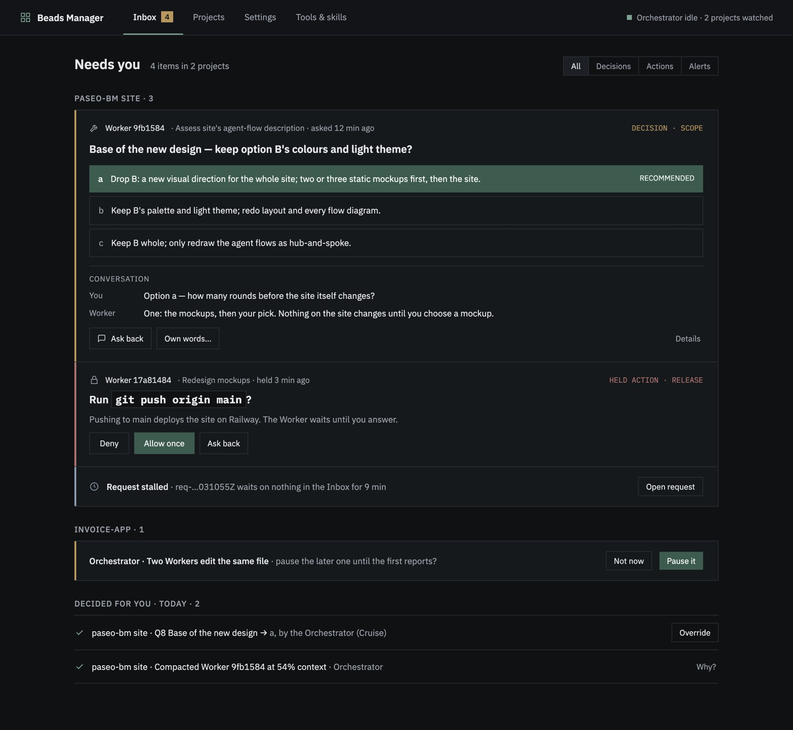

# paseo-bm-plugin — Beads Management for Paseo

paseo-bm is a small agent team and project dashboard for [Paseo](https://paseo.sh). Tell the Beads Manager what outcome you want; a Worker implements and proves it, a Reviewer checks larger work, and the optional Orchestrator helps coordinate projects at the autonomy level you choose.



## What is included

- **Inbox** for decisions and alerts that need you.
- **Projects** with request timelines, Beads, metrics and agents.
- **Settings** for autonomy, coordination, roles, updates and release notes.
- **Tools & skills** for workflow skills, agent tools, `br` and `bv`.
- Manager, Worker, Reviewer and optional machine-wide Orchestrator roles.

## Install and start

Requires **Paseo 0.9.0 or newer** on macOS or Linux.

```bash
paseo plugin add npm:paseo-bm-plugin
```

Open **Beads Manager**. The first open creates the four `bm-*` role profiles with an available provider/model. Then:

1. Choose **Allow agent tools** in **Settings → More → Agents**.
2. Choose **Install skills** and install `br` / `bv` in **Tools & skills** when shown.
3. Open a project, choose **Chat ▸**, and describe the change.

## Update and see what changed

Settings shows the installed/latest version and release notes. When an update is available, choose **Update now** and confirm it, or run:

```bash
paseo plugin update paseo-bm
```

Every version links to its release-note source in the repository. The same file is used for GitHub Releases and the in-plugin changelog.

## Before you install

- Paseo plugins run **without a sandbox** and have the daemon's machine access.
- **Allow agent tools** is a machine-wide Paseo switch, not limited to paseo-bm.
- Workers run without interactive permission prompts. Review the diff before committing.
- **Install skills** runs the third-party [`skills` CLI](https://github.com/cuongntr/agent-skills), which downloads another author's project.
- Starting the Orchestrator sends masked project context to its model provider and uses provider tokens.

See the [full safety and data guide](https://github.com/hieunt286/paseo-bm/blob/main/GUIDE.md#before-you-install-read-these-warnings).

## Remove

Open **Settings → More → Data**, choose **Remove paseo-bm's settings…**, then run:

```bash
paseo plugin remove paseo-bm
```

Paseo has no plugin-removal hook, so skipping the Settings action leaves the `bm-*` configuration behind.

## If you installed paseo-bm with `npx paseo-bm` before

That is a directory install. If Paseo reports:

```text
Plugin ID "paseo-bm" is already configured; choose another ID with --id
```

Do **not** choose another id. Follow the [migration guide](https://github.com/hieunt286/paseo-bm/blob/main/GUIDE.md#coming-from-the-npx-install) and run the one-time command `npx paseo-bm@0.4.0`.

## Links

- [Guided tour](https://paseo-bm.erai.pro)
- [Full guide](https://github.com/hieunt286/paseo-bm/blob/main/GUIDE.md)
- [Release notes](https://github.com/hieunt286/paseo-bm/tree/main/docs/releases)
- Troubleshooting: `paseo plugin ls` and `paseo plugin logs paseo-bm`

MIT licensed. See [LICENSE](LICENSE).
